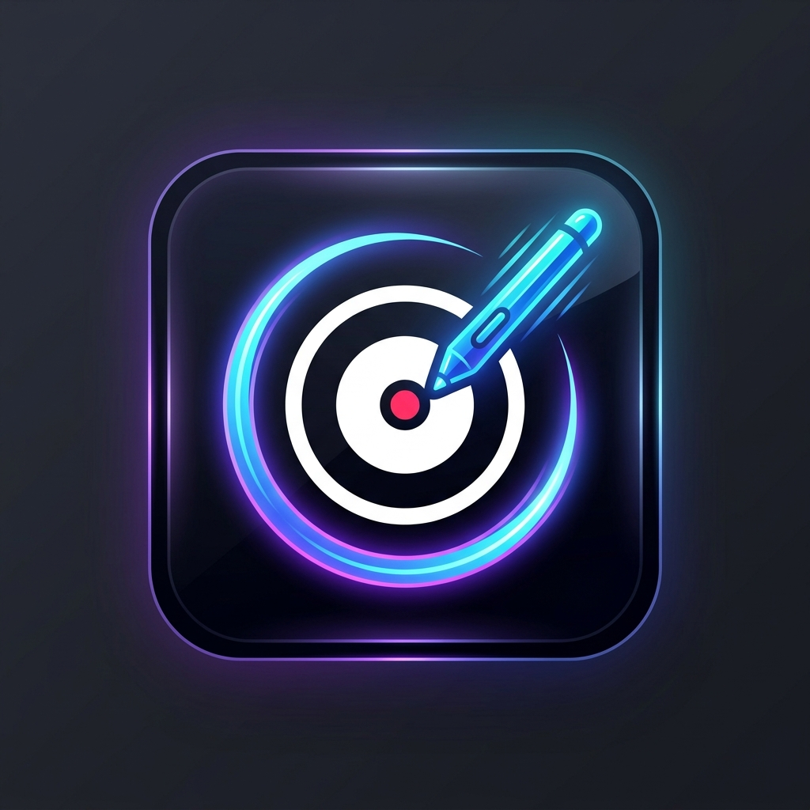

<p align="center">
  
</p>

<h1 align="center">Drox Screen Studio</h1>

<p align="center">
  <strong>The Ultimate Desktop Annotation, Live Teaching & Synchronized Screen/Microphone Recording Suite for Windows</strong>
</p>

<p align="center">
  
  
  
  
  
  
</p>

---

## 💡 Overview

**Drox Screen Studio** is an ultra-fast, modern, GPU-accelerated desktop drawing and interactive presentation studio built specifically for educators, content creators, developers, and presenters. It supercharges online meetings and lecture delivery (Zoom, Microsoft Teams, Google Meet, OBS Studio, YouTube tutorials) by letting you draw directly over any slide, code editor, browser, or active window with buttery-smooth 60 FPS rendering.

Unlike standard annotation tools that lock your mouse or require clunky third-party recorders, Drox includes a **native, high-performance GDI screen and microphone audio recorder with pause/resume support, custom folder selection, and one-click mouse pass-through**.

---

## ✨ Key Features

### 🎬 1. Synchronized Screen & Microphone Recording
- **High-Efficiency Capture**: Captures desktop video at a steady 25-30 FPS using Windows GDI `BitBlt` with crisp cursor overlay.
- **Microphone Audio Sync**: Records audio simultaneously using `sounddevice` and muxes video + audio into standard H.264/AAC `.mp4` using FFmpeg.
- **Live Elapsed Timer**: Pulsing recording badge and live timer (`00:15`, `02:45`) on the floating toolbar.
- **One-Click Mute Toggle**: Dedicated `🎙️` button to mute/unmute your microphone in real-time.

### ⏸️ 2. Seamless Pause & ▶️ Resume Support
- Need to take a breath or find a slide? Press **`F8`** or click **`⏸️ PAUSE`**.
- The video capture and microphone stream pause instantly with accurate duration calculation.
- Press **`▶️ RESUME`** to continue recording seamlessly without audio stutter or desync.

### 📁 3. Custom Recording Folder & Smart Explorer Integration
- **Folder Management**: Click the toolbar **`📁`** button to open a sleek context menu:
  - **📂 Open Recordings Folder**: Opens Windows File Explorer straight into your active destination.
  - **⚙️ Change Recording Folder...**: Select any custom directory or external drive via Windows folder picker.
- **Persistent Memory**: Your selected folder is automatically saved to `settings.json` and remembered across sessions.
- **Auto-Highlight on Finish**: When stopping a recording with **`F9`** or **`⏹️ STOP`**, Windows Explorer automatically opens with the newly generated video file selected and highlighted.

### 👆 4. Instant Mouse Pass-Through (`F2` / `Ctrl+Space`)
- Never get stuck unable to advance PowerPoint slides or click links in a browser while annotating.
- Tap **`F2`** or Right-Click anywhere to let mouse clicks pass directly through to underlying applications. Tap again to resume drawing instantly.

### 🎨 5. Complete Annotation & Smart Shapes Suite
- **✏️ Freehand Pen & 🖍️ Fluorescent Highlighter**: Ultra-smooth anti-aliased strokes with variable thickness and color palette.
- **🔴 Fading Laser Pointer**: Real-time cursor laser dot with fading trail that guides student attention without leaving permanent marks.
- **🔦 Audience Spotlight**: Focuses attention on key formulas or code snippets by dimming the background and illuminating only a spotlight around your cursor (resizeable via Mouse Wheel).
- **📐 Smart Shapes**: Arrows, Straight Lines, Rectangles, and Ellipses (`C` / `O`).
- **🔢 Auto-Increment Step Badges**: Place clean numbered badges `(1)`, `(2)`, `(3)...` on diagrams for step-by-step walkthroughs.
- **T In-Place Text Tool**: Click and type clean notes directly on screen. Keyboard shortcuts are intelligently paused during typing so your text input is uninterrupted.

### 📄 6. Blackboard, Whiteboard & Math Grid Modes
- Instant one-click transformation into a **Pure Whiteboard**, **Matte Dark Blackboard**, or **Math Grid / Graph Paper** canvas.

### 📸 7. Instant Screenshot & Clipboard Copy (`Ctrl+S`)
- Grab the screen with annotations, automatically copy it to the Windows Clipboard, and save it to the `screenshots/` directory with one keystroke.

### 🪟 8. Floating Draggable Glassmorphic Toolbar
- Dual-row compact control bar with acrylic blur effect.
- Fully draggable anywhere on screen.
- Minimizes into a discreet floating mini pill (`─`) to keep your presentation clean.

---

## ⌨️ Keyboard Shortcuts

| Shortcut | Action | Description |
| :--- | :--- | :--- |
| **`F9`** / **`Ctrl + R`** | **Start / Stop Recording** | Toggles screen + mic recording to MP4 |
| **`F8`** | **Pause / Resume Recording** | Pauses or resumes the ongoing recording |
| **`F2`** / **`Ctrl + Space`** | **Mouse Pass-Through** | Interact with desktop/slides directly |
| **`P`** | **Pen Tool** | Freehand pen drawing |
| **`H`** | **Highlighter Tool** | Semi-transparent marker |
| **`L`** | **Laser Pointer** | Glowing laser dot with fading trail |
| **`S`** | **Spotlight Tool** | Dim screen and focus spotlight circle |
| **`A`** | **Arrow Tool** | Directional arrows |
| **`I`** | **Line Tool** | Straight lines |
| **`R`** | **Rectangle Tool** | Box frames |
| **`C`** or **`O`** | **Circle / Ellipse** | Circular callouts |
| **`B`** | **Step Badge** | Auto-incrementing step numbers `(1, 2, 3...)` |
| **`T`** | **Text Tool** | Click-to-type text annotation |
| **`E`** | **Eraser** | Erase annotation strokes |
| **`Ctrl + Z`** | **Undo** | Undo last annotation |
| **`Ctrl + Y`** | **Redo** | Redo previously undone annotation |
| **`Delete`** | **Clear Canvas** | Clear all drawings on current screen |
| **`Ctrl + S`** | **Screenshot** | Save image & copy to Clipboard |
| **Mouse Wheel** | **Resize** | Adjust brush stroke width or spotlight radius |
| **Right Click** | **Quick Mouse Mode** | Return to mouse interaction mode |
| **`Esc`** | **Exit Draw Mode** | Switch back to mouse pointer |
| **`Ctrl + Q`** / **`Alt + F4`** | **Quit Application** | Safely stop recording and exit |

---

## 🚀 Quickstart & Installation

### Prerequisites
- **Operating System**: Windows 10 or Windows 11 (64-bit recommended)
- **Python**: Python 3.10, 3.11, or 3.12 installed ([python.org](https://www.python.org/downloads/))

### 1. Clone the Repository
```bash
git clone https://github.com/AbdulMoizAns/drox.git
cd drox
```

### 2. Install Dependencies
```bash
pip install -r requirements.txt
```

### 3. Launch Drox Screen Studio
Run via the provided launcher batch files or directly via Python:
```bash
python main.py
```
*(Or double-click `run.bat` in the project folder).*

---

## 📦 Building Standalone Executable (.exe)

You can package Drox Screen Studio into a standalone Windows `.exe` using PyInstaller:

```bash
pip install pyinstaller
pyinstaller --noconfirm --onedir --windowed --icon "assets/icon.ico" --add-data "assets;assets" main.py --name "DroxScreenStudio"
```

---

## 🏗️ Project Architecture

```
drox/
├── assets/
│   ├── icon.ico           # Windows multi-size application icon
│   ├── icon.png           # High-resolution app icon
│   └── logo.png           # Repository banner & showcase logo
├── canvas.py              # Fullscreen transparent drawing overlay, boards & stroke renderer
├── hotkeys.py             # System-wide keyboard hooks & typing-state detector (pynput)
├── models.py              # Geometric annotation primitives (Pen, Line, Arrow, Rect, Badge, Text)
├── recorder.py            # High-speed GDI BitBlt screen capture + audio recorder + FFmpeg muxer
├── toolbar.py             # Glassmorphic floating draggable control bar & context menus
├── main.py                # Main application lifecycle, settings persistence & signal orchestrator
├── settings.json          # Persistent user configurations (custom recording paths)
├── requirements.txt       # Project Python package dependencies
├── run.bat                # Windows quick launcher
└── README.md              # Documentation & guide
```

---

## 🇵🇰 Roman Urdu Guide (اردو رہنمائی)

**Drox Screen Studio** ek high-performance screen annotation aur recording software hai jo online teachers, YouTube creators aur programmers ke liye design kiya gaya hai:

1. **Screen + Mic Recording (`F9`):** Screen ke sath aapka mic sound HD MP4 format mein record hota hai.
2. **Pause / Resume (`F8`):** Lecture ke dauran jab chahein recording pause karein aur dobara wahi se shuru karein.
3. **Recording Folder (`📁`):** Toolbar par folder icon par click karke aap apna recording folder change kar sakte hain ya direct khol sakte hain.
4. **Mouse Pass-Through (`F2`):** PowerPoint slides ya browser par click karne ke liye `F2` dabayein, slides change karein aur foran wapas drawing shuru karein.
5. **Smart Tools:** Pen (`P`), Highlighter (`H`), Laser pointer (`L`), Spotlight (`S`), Step badges (`B`), aur Text typing (`T`).

---

## 📄 License

This project is licensed under the [MIT License](LICENSE) - feel free to use, modify, and distribute for personal, educational, or commercial projects.

---

<p align="center">
  Crafted with ❤️ by <strong>Abdul Moiz Ansari</strong>
</p>
